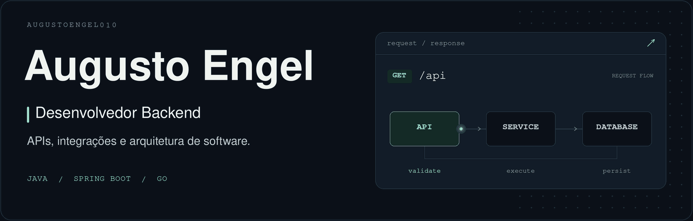

  <picture>
    <source media="(max-width: 600px)" srcset="./assets/augusto-mobile.gif" />
    
  </picture>

  <a href="https://www.linkedin.com/in/augusto-engel-29153b256/"><strong>LinkedIn ↗</strong></a>
  &nbsp; · &nbsp;
  <a href="https://github.com/AugustoEngel010/monitor-disponibilidade"><strong>Projeto em destaque ↗</strong></a>
  &nbsp; · &nbsp;
  <a href="https://github.com/augusto-engel"><strong>GitHub profissional ↗</strong></a>

Sou **Augusto Engel**, desenvolvedor backend. Trabalho com **Java e Spring Boot** no desenvolvimento de APIs REST e integrações entre sistemas.

Tenho interesse em como o software se comporta além do fluxo feliz: falhas de integração, consistência dos dados, concorrência e operação. Meus projetos pessoais são um espaço para colocar essas questões em prática, documentar decisões e testar o comportamento das soluções.

## Projeto em destaque

### [Monitor de disponibilidade ↗](https://github.com/AugustoEngel010/monitor-disponibilidade)

Monitor de APIs e sites que verifica endpoints HTTP/HTTPS, identifica quedas e recuperações e envia alertas por e-mail. Um painel reúne os monitores, o histórico de verificações, os incidentes e as tentativas de notificação.

**Java 21 · Spring Boot · PostgreSQL · Docker Compose**

| Decisão técnica | O que ela resolve |
| --- | --- |
| **Confirmação de quedas e recuperações** | Usa falhas e sucessos consecutivos para confirmar mudanças de estado antes de alertar. |
| **Outbox transacional e retries** | Grava a intenção de notificação junto da transição e retoma envios pendentes após reinícios. |
| **Concorrência controlada** | Limita os workers e impede verificações sobrepostas do mesmo monitor. |
| **Testes e rastreabilidade** | Conecta specs e critérios de aceite a testes unitários, de integração com PostgreSQL real e de interface. |

O projeto inclui execução local com Docker, API de demonstração para simular falhas, testes com **JUnit, Testcontainers, ArchUnit e Playwright**, além de CI com GitHub Actions.

**[Explorar o código](https://github.com/AugustoEngel010/monitor-disponibilidade)** · **[Executar localmente](https://github.com/AugustoEngel010/monitor-disponibilidade#início-rápido)** · **[Consultar a rastreabilidade](https://github.com/AugustoEngel010/monitor-disponibilidade/blob/main/docs/traceability.md)**

  
<strong>Ver o painel do projeto</strong>

   
  

## Tecnologias

  
  
  
  
  
  
  

## Arquitetura e evolução

Tenho aprofundado meus estudos em **Domain-Driven Design**, **Arquitetura Hexagonal** e **inteligência artificial aplicada ao backend com Spring AI e LLMs**.

Também venho aplicando **Spec-Driven Development** com a skill `tlc-spec-driven`, do **Tech Leads Club**, para conectar requisitos, decisões e testes, com mais governança e rastreabilidade.

## Atividade profissional

Este perfil reúne meus projetos pessoais e estudos. Minhas contribuições profissionais ficam na conta **[@augusto-engel](https://github.com/augusto-engel)**.

Para conversar sobre desenvolvimento e oportunidades: **[LinkedIn ↗](https://www.linkedin.com/in/augusto-engel-29153b256/)**.
